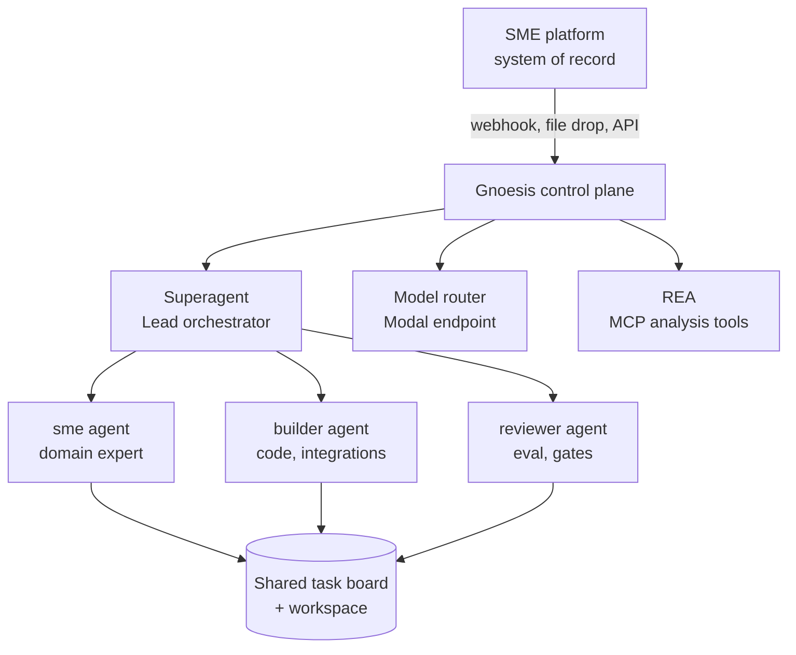

# 009 Composable SME plan

A deployment plan for putting one Gnoesis control plane into any industry SME platform. The control plane is the same in every industry; the industry enters as an SME pack — a set of specialist agents, skills, and domain references — mounted onto the same orchestrator. Two jobs run on one spine: **build** during the working day and **RSI** overnight.

## Layers

The platform exposes work to the control plane through a source adapter and receives results through a channel. Nothing in the control plane names an industry.

## SME pack

An SME pack is the only industry-specific artifact. It contains:

- **Agents** — named teammates with a mandate, a workspace scope, and a model tier. A pack ships three to six.
- **Skills** — the deterministic procedures the SME actually follows (quote a job, reconcile a ledger, triage a claim), each a `SKILL.md` plus scripts.
- **References** — point-in-time domain data the agents may read: price books, tariff tables, compliance checklists.
- **Eval set** — held-out cases with an expected outcome, used by the reviewer agent and by the nightly RSI loop.

A pack is versioned and hashed. Promotion of a pack uses the same rule as a model: it must beat the incumbent on the pack's eval set out of sample.

## Build loop (working day)

1. **Intake** — a source adapter turns a platform event into a Trigger.
2. **Triage** — Superagent evaluates the Trigger and creates a Ticket with a Mandate, or stops.
3. **Fan-out** — the Lead assigns tasks on the shared board: SME agent drafts, builder agent implements, reviewer agent gates.
4. **Deliver** — the result returns to the platform through its channel, with the evidence bundle attached.

## RSI loop (evening)

The same agents run unattended against the day's record:

1. **Mine** — read the day's tickets, failures, and corrections; group them into failure classes.
2. **Hypothesize** — one falsifiable hypothesis per class, with the expected effect on the eval set.
3. **Experiment** — variant skill, prompt, or agent roster; run on train/validation split of the eval set.
4. **Evaluate** — compare against the incumbent pack on the held-out split, counting every trial.
5. **Promote or discard** — challenger replaces champion only on an out-of-sample win; otherwise the hypothesis is logged as rejected.
6. **Reflect** — write the post-mortem and update the pack's playbook.

Every RSI cycle leaves a record: hypothesis, config, results, decision. No live capital or irreversible platform action is ever taken by the nightly loop.

## Porting to a new industry

1. Mount the platform adapter (two functions: read event, write result).
2. Author the SME pack: agents, skills, references, eval set.
3. Run the eval set against the stock roster to establish a baseline.
4. Enable the build loop for a pilot cohort, RSI off.
5. Enable the RSI loop once the baseline is stable for two weeks.

The control plane changes nothing between steps 1 and 5. Porting cost is the pack.

## Operating constraints

- Model access runs through one OpenAI-compatible endpoint, so a provider swap is a model change.
- REA is mounted as MCP, not as a skill: its tools are analysis primitives shared by every pack.
- Teams are durable roster plus task board, scoped per platform tenant.
- Human approval gates: any platform write above the pack's declared threshold, any pack promotion, any change to the ticket Mandate.
